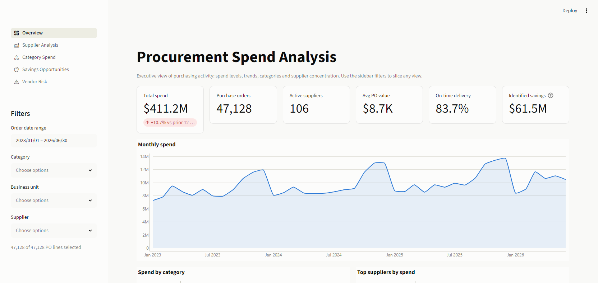
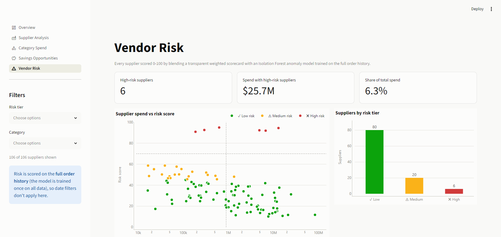
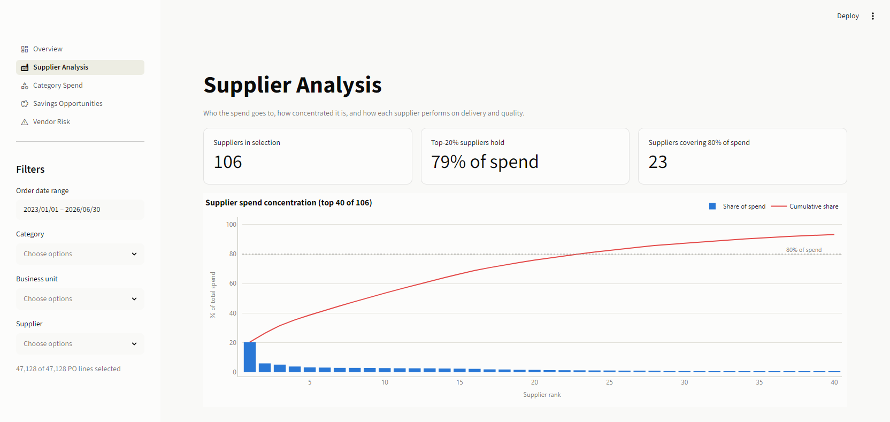
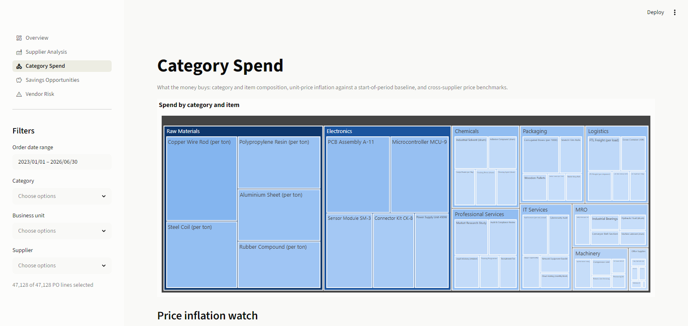
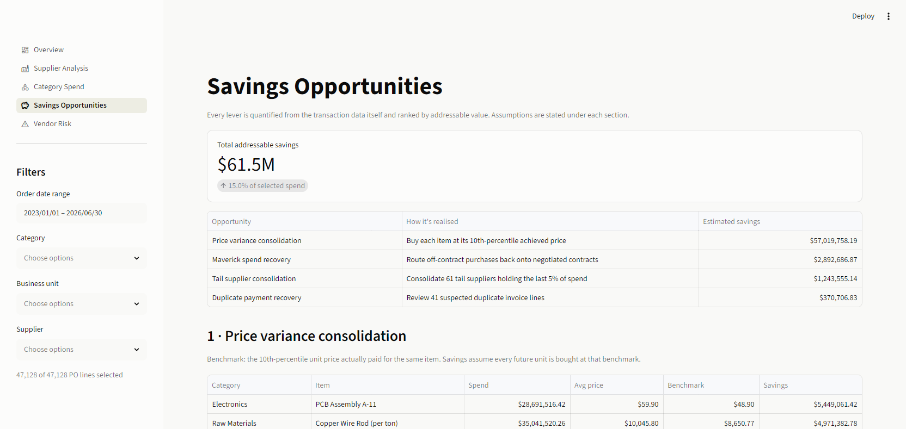

# Procurement Spend Analysis Dashboard


An interactive procurement analytics dashboard that turns raw purchase-order
data into decisions: where the money goes, which prices are drifting, where
savings are hiding, and which vendors are quietly becoming a risk.

Built with **Python, Pandas, Streamlit and Plotly**, with an
**Isolation Forest** model (scikit-learn) powering vendor risk scoring.



## What it does

| Page | Questions it answers |
|---|---|
| **Overview** | How much are we spending, with whom, and is it trending up? Which categories are single-source dependent? |
| **Supplier Analysis** | How concentrated is the supply base (Pareto)? How does each supplier perform on delivery and quality? |
| **Category Spend** | What does the money buy? Which categories have genuine unit-price inflation vs mix shift? |
| **Savings Opportunities** | Quantified, ranked levers: price-variance consolidation, maverick spend, tail consolidation, duplicate payments |
| **Vendor Risk** | Which suppliers score high on a 0–100 risk scale, and exactly why? |

Global sidebar filters (date range, category, business unit, supplier) slice
every view; all KPIs and charts recompute live.

## Highlights

- **$61.5M of addressable savings** identified from the demo dataset —
  every dollar traceable to specific transactions and stated assumptions.
- **ML-assisted vendor risk scoring**: a transparent weighted scorecard
  (late deliveries, quality rejects, price volatility, off-contract buying)
  blended with an Isolation Forest anomaly model, so unusual behaviour is
  flagged even when no single metric breaches its threshold.
- **Duplicate payment detection**: invoice lines matching on supplier, item,
  quantity and amount within a 3-day window are flagged for recovery.
- **Mix-adjusted price indices**: category inflation is measured per item
  against its own baseline and spend-weighted, so a change in purchase mix
  never masquerades as a price increase.



<details>
<summary><b>More screenshots</b></summary>





</details>

## Quickstart

```bash
git clone https://github.com/dytcoke23/procurement-spend-analysis-dashboard.git
cd procurement-spend-analysis-dashboard

python -m venv venv
venv\Scripts\activate        # Windows  (source venv/bin/activate on macOS/Linux)

pip install -r requirements.txt
streamlit run app.py
```

The app opens at `http://localhost:8501`. The dataset and trained model are
committed, so it works immediately — no generation or training step needed.

## Tech stack

| Layer | Technology | Role |
|---|---|---|
| Application | Python 3.11+ | Analytics, feature engineering and orchestration |
| Dashboard | Streamlit 1.51+ | Multi-page UI, filters, caching and tables |
| Data | Pandas, NumPy | Validation, aggregation and vectorised calculations |
| Visualisation | Plotly | Interactive trends, Pareto, treemap and risk charts |
| Machine learning | scikit-learn | StandardScaler + Isolation Forest supplier anomaly model |
| Model persistence | Joblib | Versioned local model artifact |
| Quality | Pytest, Ruff, GitHub Actions | Regression tests, linting and Python 3.11/3.14 CI |

The app is intentionally self-contained: no database, cloud credentials, API keys or
external services are required for the synthetic demo dataset.

### Regenerate the data or retrain the model

```bash
python scripts/generate_data.py      # rebuild data/purchase_orders.csv (seeded, reproducible)
python scripts/train_risk_model.py   # retrain models/vendor_risk_model.joblib
```

For development, install `requirements-dev.txt`, then run the full local quality gate:

```bash
python -m pip install -r requirements-dev.txt
python -m ruff check .
python -m compileall -q app.py src views scripts tests
python -m pytest -q
```

## The dataset

`data/purchase_orders.csv` holds **~47,000 purchase-order lines** (Jan 2023 –
Jun 2026) across **106 suppliers**, **10 categories** and 5 business units:
order/promise/delivery dates, supplier and country, item, unit price,
quantity, payment terms, contract status and quality outcome.

It is synthetic but engineered to behave like real procurement data, with a
fixed random seed for full reproducibility. Realistic structure is baked in —
Pareto-shaped spend concentration, category-specific price inflation,
cross-supplier price variance on identical items, Q4 seasonality, off-contract
buying concentrated in certain business units, a single-sourced category, a
handful of chronically late/erratic vendors, and a few near-duplicate
invoices. The dashboard's job is to surface all of it.

## How the vendor risk score works

1. **Feature engineering** (`src/risk_features.py`) — per supplier: late
   delivery rate, average delay days, quality reject rate, price volatility
   (std dev of unit price vs the item's market median that month),
   off-contract share, order-value variability.
2. **Composite scorecard (55%)** — each feature scaled against a risk cap and
   weighted (late rate 30%, rejects 25%, volatility 20%, delay 15%,
   off-contract 10%). Fully auditable: the dashboard shows each factor's
   point contribution per supplier.
3. **Anomaly model (45%)** — `StandardScaler → IsolationForest` (300 trees)
   trained on all supplier feature vectors; the anomaly ranking catches
   suppliers whose overall pattern is unusual.
4. **Tiers** — High ≥ 70, Medium ≥ 45, else Low.

## Savings methodology

| Lever | How it's quantified |
|---|---|
| Price variance consolidation | Every unit repriced at the item's 10th-percentile achieved price (items with 3+ suppliers) |
| Maverick spend recovery | 5% assumed uplift paid on off-contract purchases |
| Tail supplier consolidation | 6% assumed saving on spend held by suppliers beyond 95% cumulative spend |
| Duplicate payment recovery | Face value of invoice lines matching another line within 3 days |

All assumptions live in `src/config.py` and are stated in the UI next to each
number.

## Project structure

```
app.py                     Streamlit entry point (st.navigation router)
views/                     One file per dashboard page
src/
  config.py                Paths, palette, analysis assumptions
  data_loader.py           Cached loading + shared sidebar filters
  analytics.py             KPIs, Pareto, price indices, savings logic
  risk_features.py         Supplier feature engineering + risk scoring
  charts.py                Reusable Plotly chart builders (one visual system)
scripts/
  generate_data.py         Seeded synthetic dataset generator
  train_risk_model.py      Trains and saves the Isolation Forest pipeline
data/purchase_orders.csv   The dataset (committed for instant startup)
models/                    Trained model artifact (joblib)
tests/                     Pytest suite for the analytics core
.github/workflows/ci.yml   Lint, compile and test matrix for pull requests
```

## Data and security notes

- The included data is synthetic and contains no personal or commercially sensitive data.
- `joblib` model files should only be loaded from trusted sources; serialized Python objects
  can execute code while loading.
- Real datasets must retain the documented CSV schema. The loader rejects missing columns,
  invalid booleans, negative financial values and inconsistent line totals before analysis.
- Savings values are addressable estimates, not booked savings or financial advice. Validate
  suspected duplicates and sourcing assumptions before taking action.

Contributions are welcome; see [CONTRIBUTING.md](CONTRIBUTING.md).

## Roadmap

- Contract coverage analysis (expiry calendar, renewal alerts)
- Supplier delivery lead-time forecasting
- Currency-aware multi-region spend consolidation
- Export packs (PDF/PowerPoint) for sourcing reviews

## License

[MIT](LICENSE)
